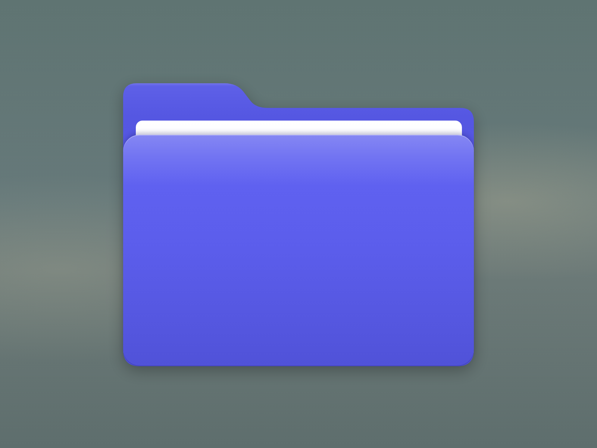

# apple-folder

A macOS-style folder icon drawn with pure HTML and CSS — no images or SVG.



## Usage

Open `index.html` in a browser.

To resize the icon, change the `--size` variable in `:root`:

```css
:root {
    --size: 470px;
}
```

The shape is drawn on a 470 × 381 grid and scaled with `transform`, so it stays crisp at any size.

## Formatting

The code is formatted with [Prettier](https://prettier.io):

```sh
npm install
npm run format        # format all files
npm run format:check  # check without writing
```
